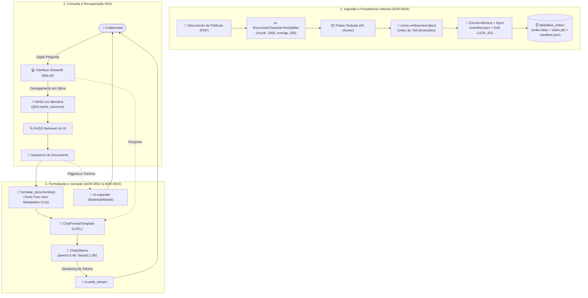

# 💼 Assistente de RH com IA (RAG Local) — V2

[](https://www.python.org/)
[](https://streamlit.io/)
[](https://www.langchain.com/)
[](https://github.com/facebookresearch/faiss)
[](https://ollama.com/)
[](tests/)

Assistente inteligente de Recursos Humanos para consulta de políticas internas corporativas (férias, benefícios, jornada de trabalho e conduta), desenvolvido com a arquitetura **RAG (Retrieval-Augmented Generation)**.

A aplicação opera **100% localmente e com privacidade estrita** através do Ollama no host nativo, evitando o tráfego de dados confidenciais ou documentos corporativos para APIs externas de IA.

---

## 📖 Evolução do Projeto: Da PoC (V1) à Versão Estabilizada (V2)

O projeto passou por um ciclo contínuo de refatoração, governança de arquitetura e engenharia de produção:

```text
OpenAI (PoC inicial com gpt-4o-mini + text-embedding-3-small)
  │
  ▼
Dependência e esgotamento de cota de API externa
  │
  ▼
Migração para IA Local (Ollama: nomic-embed-text + Mistral/Qwen)
  │
  ▼
Ambiente Híbrido de Desenvolvimento (Windows Host + WSL2 Ubuntu)
  │
  ▼
Migração para Ubuntu 26.04 Nativo (CPU i7 + Ollama via systemd)
  │
  ▼
Governança Arquitetural Formal via ADRs (docs/adr/ ADR-0001 a ADR-0005)
  │
  ▼
Conectividade Determinística & Healthcheck Semântico (ADR-0001)
  │
  ▼
Catálogo Dinâmico & Separação de Modelos (ADR-0002)
  │
  ▼
Formatação Estrita de Contexto LCEL sem Vazamento de Classes (ADR-0003)
  │
  ▼
Persistência FAISS Atômica, Manifesto JSON & Startup Recovery (ADR-0004)
  │
  ▼
Governança de Dependências sob Python 3.14 & Suíte Automatizada (ADR-0005)
```

1. **Prova de Conceito Inicial (OpenAI):** O protótipo inicial utilizava APIs externas da OpenAI (`text-embedding-3-small` e `gpt-4o-mini`) em um único arquivo de script.
2. **Transição para IA Local (Ollama na V1):** O pipeline foi adaptado para modelos locais sob Ollama, operando inicialmente em topologia híbrida Windows + WSL2.
3. **Estabilização e Engenharia de Produção (V2):**
   - Transição definitiva para **Ubuntu 26.04 nativo** com serviço systemd do Ollama.
   - Formalização de 5 decisões de arquitetura em [docs/adr/](docs/adr/README.md).
   - Eliminação de subprocessos de rede (`ip route`) substituídos por resolução determinística e healthcheck semântico em `GET /api/version`.
   - Consulta dinâmica de modelos de chat via `/api/tags`, isolando o modelo de embeddings (`nomic-embed-text:latest`) e modelos de código puro.
   - Formatação pura de texto do contexto na chain LCEL, impedindo o vazamento de sintaxe de classes Python para o modelo.
   - Persistência vetorial em disco com `manifest.json`, sincronização atômica (`fsync`), travas `fcntl` e recuperação de inicialização com quarentena técnica.
   - Suíte de 39 testes automatizados com `pytest` cobrindo cliente, chain, persistência e interface.

---

## 🏛️ Arquitetura do Pipeline RAG (V2)



---

## 🖥️ Topologia de Execução: Desenvolvimento vs Produção

### Ambiente Principal de Desenvolvimento (Ubuntu 26.04 Nativo)

No ambiente de desenvolvimento e execução local, tanto o serviço do Ollama (gerenciado pelo `systemd`) quanto a aplicação Python (Streamlit em `.venv`) operam diretamente no host Linux, comunicando-se deterministicamente via loopback em `http://127.0.0.1:11434`:

```text
┌─────────────────────────────────────────────────────────────┐
│                   Host Ubuntu 26.04 LTS                     │
│                                                             │
│  Servidor Ollama (systemd) ───────► http://127.0.0.1:11434  │
│                                              ▲              │
│                                              │ (loopback)   │
│  Streamlit App (.venv) ──────────────────────┘              │
│     ├── app.py (Interface, Rastreabilidade & Config)        │
│     └── rag/                                                │
│          ├── ollama_client.py (URL & Catálogo Dinâmico)     │
│          ├── ingest.py (FAISS Persistente + Manifesto)      │
│          └── chain.py (LCEL + Formatação Estrita)           │
└─────────────────────────────────────────────────────────────┘
```

> **Contexto Histórico (V1 sob Windows + WSL2):** No protótipo inicial, o Ollama executava no Windows Host e a aplicação no subsistema WSL2. O mecanismo legado de resolução de rota via comando shell `ip route` foi completamente removido na V2, substituído por resolução determinística via `OLLAMA_BASE_URL` ou `http://127.0.0.1:11434` conforme a [ADR-0001](docs/adr/0001-resolucao-conectividade-ollama.md).

### Arquitetura Alvo em Produção Corporativa

Para um ambiente corporativo expandido, a aplicação é isolada e protegida por camadas de segurança perimetral e identidade:

```text
[ Colaborador ]
       │ (HTTPS / VPN Corporativa)
       ▼
[ Reverse Proxy / Ingress (Nginx / Traefik) ] ─── [ SSO / OIDC (Microsoft Entra / Okta) ]
       │
       ▼
[ Container Streamlit (app.py + rag) ]
       ├── [ Banco Vetorial (FAISS Persistente / PgVector) ]
       └── [ Servidor de Inferência Dedicado (Ollama / vLLM com GPU corporativa) ]
```

---

## ⚖️ Decisões de Engenharia e Arquitetura (ADRs V2)

| Decisão Técnica | Implementação na V2 | Justificativa / Impacto | Referência |
| :--- | :--- | :--- | :--- |
| **Resolução Determinística de Rede** | `obter_url_ollama()` sem subprocessos | Prioriza `OLLAMA_BASE_URL` com fallback estrito para `127.0.0.1:11434`. Valida portas (1-65535), IPv6 e rejeita query strings. | [ADR-0001](docs/adr/0001-resolucao-conectividade-ollama.md) |
| **Healthcheck Semântico** | `verificar_conexao_ollama()` | Consulta `GET /api/version` validando status HTTP 200 e payload JSON contendo o atributo `"version"` não vazio. | [ADR-0001](docs/adr/0001-resolucao-conectividade-ollama.md) |
| **Catálogo Dinâmico de Modelos** | `listar_modelos_chat()` via `/api/tags` | Detecta modelos instalados em tempo de execução, isolando modelos de embedding e filtrando modelos não conversacionais. | [ADR-0002](docs/adr/0002-catalogo-modelos-ollama.md) |
| **Separação Embeddings vs Chat** | `nomic-embed-text:latest` fixado | A seleção ou troca de modelo de LLM na UI recria apenas o gerador, sem reprocessar embeddings ou reler documentos. | [ADR-0002](docs/adr/0002-catalogo-modelos-ollama.md) |
| **Formatação Estrita LCEL** | `formatar_documentos()` | Função pura que extrai o texto dos chunks e concatena com quebra dupla, impedindo vazamento de objetos `Document` no prompt. | [ADR-0003](docs/adr/0003-formatacao-contexto-lcel.md) |
| **Rastreabilidade de Fontes** | `st.expander` na UI | Exibe as páginas e trechos recuperados diretamente associados à pergunta atual na interface do colaborador. | [ADR-0003](docs/adr/0003-formatacao-contexto-lcel.md) |
| **Persistência Atômica do Índice** | `salvar_indice_persistente()` | Gravação atômica em `.tmp`, `fsync` e substituição segura em `data/faiss_index/` sob trava exclusiva `fcntl.flock(LOCK_EX)`. | [ADR-0004](docs/adr/0004-persistencia-faiss.md) |
| **Manifesto de Integridade** | `manifest.json` | Valida versão do esquema, hash SHA-256 do PDF, `chunking_config_hash`, dimensão vetorial (768) e total de chunks. | [ADR-0004](docs/adr/0004-persistencia-faiss.md) |
| **Validação sem Embeddings** | `similarity_search_by_vector()` | Valida a integridade do índice FAISS com vetor sintético zerado, eliminando chamadas desnecessárias de rede ao Ollama. | [ADR-0004](docs/adr/0004-persistencia-faiss.md) |
| **Startup Recovery e Quarentena** | `recuperar_na_inicializacao()` | Detecta índices corrompidos, restaura backups funcionais e isola falhas em pastas de quarentena com timestamp. | [ADR-0004](docs/adr/0004-persistencia-faiss.md) |
| **Governança de Dependências** | Python 3.14 + `.venv` | Matriz limpa sem `langchain-openai`, `faiss-cpu>=1.16.0` compatível com ABI3 e dependências travadas. | [ADR-0005](docs/adr/0005-dependencias-e-compatibilidade.md) |

> 📖 **Documentação Arquitetural Completa:** Para consultar as motivações técnicas aprofundadas, alternativas descartadas e critérios de validação de cada decisão, veja o [Índice de ADRs (docs/adr/README.md)](docs/adr/README.md).

---

## 📁 Estrutura Modular do Projeto

```text
agente-ia-rh/
├── app.py                      # Interface de usuário interativa (Streamlit)
├── docs/                       # Documentação técnica e governança
│   └── adr/                    # Architecture Decision Records (ADRs 0001 a 0005)
├── rag/                        # Módulo central de RAG (Lógica de Negócio)
│   ├── __init__.py             # Exportações públicas da biblioteca
│   ├── ollama_client.py        # Conector Ollama, validação de URL e catálogo dinâmico
│   ├── ingest.py               # Ingestão PDF, persistência FAISS, manifesto e locks
│   └── chain.py                # Composição LCEL e formatação estrita de contexto
├── tests/                      # Suíte de testes automatizados com pytest
│   ├── __init__.py             # Pacote de testes
│   ├── conftest.py             # Fixtures globais e configuração do PYTHONPATH
│   ├── test_ollama_client.py   # Testes de URL, conectividade e catálogo (ADRs 0001, 0002)
│   ├── test_chain.py           # Testes de formatação de contexto e LCEL (ADR-0003)
│   ├── test_ingest.py          # Testes de manifesto, persistência e recovery (ADR-0004)
│   └── test_app.py             # Testes de integração da interface Streamlit (AppTest)
├── data/
│   ├── politica_rh_exemplo.pdf # Documento sintético didático para demonstração
│   └── faiss_index/            # Índice vetorial persistido localmente (ignorado no git)
│       ├── index.faiss         # Estrutura de busca vetorial C++
│       ├── index.pkl           # Catálogo de metadados e docstore Python
│       └── manifest.json       # Manifesto de integridade e compatibilidade
├── Dockerfile                  # Definição de container (Python 3.11-slim)
├── docker-compose.yml          # Orquestração do serviço
├── requirements.txt            # Dependências de produção governadas pela ADR-0005
├── requirements-dev.txt        # Dependências de desenvolvimento e testes (pytest)
├── .env.example                # Template documentado de variáveis de ambiente
├── .gitignore                  # Exclusão de índices gerados, caches e segredos
└── README.md                   # Documentação arquitetural e técnica do projeto
```

---

## 🚀 Como Executar

### 1. Pré-requisitos
- **Python 3.10+** (validado nativamente em Python 3.14 no Ubuntu 26.04)
- **Ollama** instalado e em execução ([Download Ollama](https://ollama.com/download))

Baixe os modelos recomendados no Ollama:
```bash
# Modelo de Embeddings (obrigatório para indexação FAISS)
ollama pull nomic-embed-text

# Modelos de Linguagem para Chat (baixe o padrão e/ou o alternativo)
ollama pull qwen3.5:4b      # Modelo padrão recomendado (raciocínio leve e ágil na CPU)
ollama pull llama3.1:8b     # Modelo alternativo para respostas mais densas
```

---

### Opção A: Execução Local com Python Virtualenv (Recomendado)

1. **Clone o repositório:**
   ```bash
   git clone https://github.com/niqueborges/agente-ia-rh.git
   cd agente-ia-rh
   ```

2. **Crie e ative o ambiente virtual:**
   ```bash
   python3 -m venv .venv
   source .venv/bin/activate
   ```

3. **Instale as dependências:**
   ```bash
   pip install -r requirements.txt
   ```

4. **Inicie a aplicação:**
   ```bash
   streamlit run app.py
   ```

Acesse a interface no navegador: `http://localhost:8501`.

---

### Opção B: Execução via Docker Compose

Caso prefira executar a aplicação em container:

```bash
docker compose up --build
```

Acesse a interface no navegador: `http://localhost:8501`.

---

## 🧪 Executando os Testes e o Benchmark de Qualidade

### 1. Suíte de Testes Automatizados (pytest)

O projeto conta com uma suíte de 39 testes unitários e de integração cobrindo todas as camadas arquiteturais:

```bash
# Instale as dependências de desenvolvimento
pip install -r requirements-dev.txt

# Execute a suíte de testes completa
pytest tests/ -v
```

Exemplo de saída esperada:
```text
tests/test_app.py::TestAppStreamlit::test_app_inicializa_sem_excecoes PASSED
tests/test_app.py::TestAppStreamlit::test_app_trata_ollama_indisponivel PASSED
tests/test_chain.py::TestFormatacaoDocumentos::test_formata_lista_de_documentos_com_sucesso PASSED
tests/test_ingest.py::TestPersistenciaEStartupRecovery::test_salvar_indice_persistente_cria_manifesto_e_arquivos PASSED
tests/test_ollama_client.py::TestValidacaoUrlOllama::test_url_sem_esquema_adiciona_http PASSED
...
======================= 39 passed in 0.93s =======================
```

### 2. Benchmark Sistemático de Qualidade (Etapa 3)

Para reproduzir a avaliação comparativa de recuperação, fidelidade e latência na CPU entre os modelos:

```bash
python scripts/avaliar_rag.py
```

Os resultados detalhados são salvos em `data/benchmarks/resultado_benchmark.json` e documentados em [`docs/avaliacao-qualidade-etapa3.md`](docs/avaliacao-qualidade-etapa3.md).

---

## 🔒 Nota de Confidencialidade e Dados Fictícios

> [!NOTE]
> O arquivo [`data/politica_rh_exemplo.pdf`](data/politica_rh_exemplo.pdf) incluído neste repositório contém **dados e regras fictícias da empresa Nexus Tecnologia S.A.**, gerado exclusivamente para fins didáticos e demonstração do pipeline RAG, em estrita conformidade com as diretrizes de privacidade e LGPD.

---

## 📌 Status das Fases e Próximas Fronteiras de Evolução

Com a conclusão da estabilização da V2 e da avaliação empírica da Etapa 3, o status atual do projeto é:

### Entregas Concluídas (V2 + Etapa 3)
- [x] **Conectividade Determinística e Resiliente:** Resolução e healthcheck sem dependência de comandos de shell externos ([ADR-0001](docs/adr/0001-resolucao-conectividade-ollama.md)).
- [x] **Catálogo Dinâmico e Descoberta de Modelos:** Detecção de modelos no Ollama com separação entre geração e embeddings ([ADR-0002](docs/adr/0002-catalogo-modelos-ollama.md)).
- [x] **Higiene do Prompt LCEL:** Formatação pura de contexto sem vazamento de objetos `Document` ([ADR-0003](docs/adr/0003-formatacao-contexto-lcel.md)).
- [x] **Rastreabilidade de Fontes:** Exibição expansível na UI dos trechos e páginas consultadas ([ADR-0003](docs/adr/0003-formatacao-contexto-lcel.md)).
- [x] **Persistência Atômica do Banco Vetorial:** Armazenamento em disco com `manifest.json`, sincronização `fsync`, travas `fcntl` e tolerância a falhas ([ADR-0004](docs/adr/0004-persistencia-faiss.md)).
- [x] **Governança de Dependências:** Homologação sob Python 3.14 com 39 testes automatizados ([ADR-0005](docs/adr/0005-dependencias-e-compatibilidade.md)).
- [x] **Curadoria do Golden Dataset:** 15 perguntas de referência cobrindo os 10 capítulos do manual e controles negativos ([data/golden_dataset.json](data/golden_dataset.json)).
- [x] **Avaliação de Recuperação:** *Context Hit Rate @ 3* atingiu **91.7%**, comprovando alta eficácia da recuperação densa pura.
- [x] **Benchmark Empírico de Modelos:** Comparação de latência, vazão e fidelidade na CPU entre `qwen3.5:4b` e `llama3.1:8b`, elegendo `llama3.1:8b` (`num_ctx=2048`) como padrão recomendado ([docs/avaliacao-qualidade-etapa3.md](docs/avaliacao-qualidade-etapa3.md)).

### Próximas Fronteiras de Evolução (Trabalhos Futuros Opcionais)
- [ ] **Pipeline de CI/CD (GitHub Actions):** Automação de linting (Ruff) e testes (`pytest`) a cada push e pull request.
- [ ] **Multi-Documentos e Segmentação por Metadados:** Suporte à ingestão simultânea de manuais de diferentes departamentos (RH, TI, Financeiro, Jurídico) com filtros por coleção.
- [ ] **Autenticação Corporativa (SSO / OIDC):** Integração com Microsoft Entra ID / Okta para controle de acesso por perfil (RBAC).
- [ ] **Banco Vetorial Gerenciado:** Avaliação de migração do FAISS para PgVector ou Qdrant caso o acervo documental ultrapasse centenas de arquivos.

---

## 🎯 Síntese

O **agente-ia-rh** evoluiu de uma prova de conceito inicial para uma arquitetura local robusta, modular e totalmente auditável. Com governança via ADRs, persistência atômica, testes automatizados e inferência 100% privada, o projeto serve como referência prática de aplicação de IA generativa em ambientes corporativos sensíveis.

---

## 📚 Referências e Créditos

Este projeto teve como ponto de partida o tutorial e materiais disponibilizados no YouTube:
- **Vídeo de Referência:** [Assistente RAG com Streamlit e LangChain](https://www.youtube.com/watch?v=XqG3RN6VzDw)
- **Agradecimentos:** Aos autores do conteúdo original que serviu como ponto de partida exploratório, a partir do qual o projeto foi integralmente reestruturado com execução nativa local (Ollama), arquitetura modular em pacotes, governança de dependências, persistência atômica FAISS e suíte de testes automatizados.
