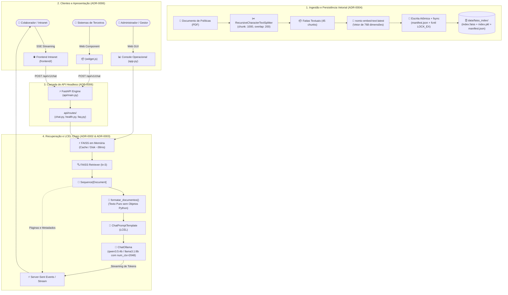

# 🛠️ Documentação Técnica e Arquitetura — Agente IA RH (V2)

[](https://www.python.org/)
[](https://fastapi.tiangolo.com/)
[](https://streamlit.io/)
[](https://www.langchain.com/)
[](https://github.com/facebookresearch/faiss)
[](https://ollama.com/)
[](../tests/)

Este documento reúne os detalhes técnicos de engenharia de software, arquitetura de pipeline RAG, decisões formais de design (ADRs), governança de dependências e métricas de qualidade do projeto **agente-ia-rh**.

> 💡 **Para usuários finais e administradores de RH:** Consulte o guia prático no [README principal do projeto](../README.md).

---

## 🏛️ Arquitetura do Pipeline RAG

O sistema adota o padrão **RAG (Retrieval-Augmented Generation)** desacoplado em camadas, executando 100% no host local Ubuntu com modelos abertos servidos pelo Ollama:



---

## 📖 Histórico de Evolução Técnica

O projeto passou por um ciclo contínuo de refatoração, governança de arquitetura e estabilização para produção:

```text
OpenAI (PoC inicial com gpt-4o-mini + text-embedding-3-small)
  │
  ▼
Dependência e esgotamento de cota de API externa
  │
  ▼
Migração para IA Local (Ollama: nomic-embed-text + Mistral/Qwen)
  │
  ▼
Ambiente Híbrido de Desenvolvimento (Windows Host + WSL2 Ubuntu)
  │
  ▼
Migração para Ubuntu 26.04 Nativo (CPU Intel i7 + Ollama via systemd)
  │
  ▼
Governança Arquitetural Formal via ADRs (docs/adr/ ADR-0001 a ADR-0006)
  │
  ▼
Conectividade Determinística & Healthcheck Semântico (ADR-0001)
  │
  ▼
Catálogo Dinâmico & Separação de Modelos (ADR-0002)
  │
  ▼
Formatação Estrita de Contexto LCEL sem Vazamento de Classes (ADR-0003)
  │
  ▼
Persistência FAISS Atômica, Manifesto JSON & Startup Recovery (ADR-0004)
  │
  ▼
Governança de Dependências sob Python 3.14 & Suíte Automatizada (ADR-0005)
  │
  ▼
Desacoplamento via API REST/SSE e Frontend Intranet & Widget (ADR-0006)
```

1. **PoC Inicial (OpenAI):** Monólito experimental consumindo APIs proprietárias em nuvem (`gpt-4o-mini`).
2. **Migração Local (V1 - WSL2):** Transição para inferência local com Ollama, com resolução de conectividade dependente de comandos de shell (`ip route`).
3. **Engenharia de Produção (V2 - Ubuntu Nativo):**
   - Transição definitiva para Ubuntu nativo, eliminando latências de virtualização.
   - Resolução determinística e healthcheck semântico sem subprocessos de shell.
   - Formatação pura LCEL e separação estrita de modelos de embeddings e chat.
   - Persistência atômica FAISS com manifesto estruturado e startup recovery.
   - Avaliação empírica com *golden dataset* (Etapa 3).
4. **Desacoplamento Headless (V2.1 - Intranet):**
   - Criação da API FastAPI com suporte a streaming Server-Sent Events (SSE).
   - Frontend estático desacoplado focado em colaboradores leigos.
   - Web Component reutilizável (`<assistente-rh-chat>`) para intranets de terceiros.

---

## ⚖️ Registro de Decisões de Arquitetura (ADRs)

Todas as decisões arquiteturais estruturantes do projeto foram formalmente aprovadas e estão documentadas em [docs/adr/](adr/README.md):

| ADR | Título | Decisão Principal | Referência |
| :--- | :--- | :--- | :--- |
| **ADR-0001** | Resolução de Conectividade do Ollama | Resolução determinística via `OLLAMA_BASE_URL` ou fallback `http://127.0.0.1:11434`, eliminação de subprocessos `ip route` e validação estrita de portas (1-65535) e URLs. | [ADR-0001](adr/0001-resolucao-conectividade-ollama.md) |
| **ADR-0002** | Catálogo Dinâmico e Separação de Modelos | Descoberta dinâmica de modelos via `/api/tags`, isolamento estrito de modelos de embedding (`nomic-embed-text`) e filtragem de modelos base não conversacionais. | [ADR-0002](adr/0002-catalogo-modelos-ollama.md) |
| **ADR-0003** | Formatação Estrita de Contexto na Chain LCEL | Função pura `formatar_documentos()` que extrai estritamente `page_content`, impedindo vazamento de objetos Python `Document(...)` para o prompt do LLM. | [ADR-0003](adr/0003-formatacao-contexto-lcel.md) |
| **ADR-0004** | Persistência Controlada do Índice FAISS | Persistência atômica com `manifest.json`, sincronização `fsync`, travas de arquivo `fcntl` (`LOCK_EX`/`LOCK_SH`) e rotina não destrutiva de startup recovery com quarentena. | [ADR-0004](adr/0004-persistencia-faiss.md) |
| **ADR-0005** | Governança de Dependências e Compatibilidade | Definição de execução nativa sob Python 3.14 como prioritária, expurgo da dependência órfã `langchain-openai` e fixação de versões estáveis (`faiss-cpu>=1.16.0`, `streamlit>=1.59.0`). | [ADR-0005](adr/0005-dependencias-e-compatibilidade.md) |
| **ADR-0006** | Desacoplamento do Backend via API REST/SSE e Frontend Intranet | Camada de serviços HTTP/SSE independente com FastAPI (`api/`), frontend estático agnóstico sem build step e Web Component embutível (`<assistente-rh-chat>`). | [ADR-0006](adr/0006-desacoplamento-api-frontend.md) |
| **ADR-0007** | Blindagem de Segurança da API e Controle de Concorrência | Semáforo de concorrência anti-DoS na CPU (máx 2 inferências), Rate Limiting por IP (10 req/min), guardrail contra prompt injection, CORS restrito e security headers. | [ADR-0007](adr/0007-blindagem-seguranca-api.md) |

---

## 📁 Estrutura Modular Completa do Código-Fonte

```text
agente-ia-rh/
├── api/                        # Camada de serviços HTTP e streaming (FastAPI - ADR-0006)
│   ├── __init__.py             # Exportação da aplicação FastAPI
│   ├── main.py                 # Inicialização, CORS corporativo e rotas estáticas
│   ├── schemas.py              # Modelos Pydantic de requisição e resposta
│   ├── security.py             # Blindagem: Rate Limiting, semáforo e guardrails (ADR-0007)
│   └── routes/                 # Roteadores modulares
│       ├── chat.py             # Endpoint /api/v1/chat (Streaming SSE e Síncrono)
│       ├── health.py           # Endpoint /api/v1/health (Diagnóstico Ollama e FAISS)
│       └── faq.py              # Endpoint /api/v1/faq (Perguntas frequentes)
├── frontend/                   # Frontend desacoplado para intranet e leigos (ADR-0006)
│   ├── index.html              # Interface amigável para colaboradores (sem termos técnicos)
│   ├── styles.css              # Estilos acessíveis e responsivos corporativos
│   ├── app.js                  # Lógica do cliente com consumo de streaming SSE
│   └── widget.js               # Web Component embutível (<assistente-rh-chat>)
├── app.py                      # Console analítico e operacional interno (Streamlit)
├── rag/                        # Módulo central de RAG (Lógica de Negócio)
│   ├── __init__.py             # Exportações públicas da biblioteca
│   ├── ollama_client.py        # Conector Ollama, validação de URL e catálogo dinâmico
│   ├── ingest.py               # Ingestão PDF, persistência FAISS, manifesto e locks
│   └── chain.py                # Composição LCEL e formatação estrita de contexto
├── tests/                      # Suíte de testes automatizados com pytest
│   ├── __init__.py             # Pacote de testes
│   ├── conftest.py             # Fixtures globais e configuração do PYTHONPATH
│   ├── test_api.py             # Testes de integração da API REST/SSE (ADR-0006)
│   ├── test_ollama_client.py   # Testes de URL, conectividade e catálogo (ADRs 0001, 0002)
│   ├── test_chain.py           # Testes de formatação de contexto e LCEL (ADR-0003)
│   ├── test_ingest.py          # Testes de manifesto, persistência e recovery (ADR-0004)
│   └── test_app.py             # Testes de integração da interface Streamlit (AppTest)
├── data/
│   ├── golden_dataset.json     # Conjunto de 15 perguntas de referência (Etapa 3)
│   ├── politica_rh_exemplo.pdf # Documento sintético didático para demonstração
│   └── faiss_index/            # Índice vetorial persistido localmente (ignorado no git)
│       ├── index.faiss         # Estrutura de busca vetorial C++
│       ├── index.pkl           # Catálogo de metadados e docstore Python
│       └── manifest.json       # Manifesto de integridade e compatibilidade
├── docs/                       # Documentação técnica e governança
│   ├── README.md               # Este arquivo (Manual Técnico e de Engenharia)
│   ├── avaliacao-qualidade-etapa3.md # Relatório técnico do benchmark empírico
│   └── adr/                    # Architecture Decision Records (ADRs 0001 a 0006)
├── scripts/
│   └── avaliar_rag.py          # Script de execução do benchmark automatizado
├── Dockerfile                  # Definição de container (Python 3.11-slim)
├── docker-compose.yml          # Orquestração do serviço
├── requirements.txt            # Dependências de produção governadas pela ADR-0005
├── requirements-dev.txt        # Dependências de desenvolvimento e testes (pytest, ruff)
├── pyproject.toml              # Configuração centralizada do Ruff e Pytest
├── CHANGELOG.md                # Registro semântico de versões
└── README.md                   # Manual principal (Visão Geral, ADM e Colaboradores)
```

---

## 📡 Contratos e Endpoints da API REST/SSE

### 1. `POST /api/v1/chat`
Endpoint principal para submissão de perguntas e recepção de respostas.

- **Payload de Entrada (`ChatRequest`):**
  ```json
  {
    "question": "Como funciona o período aquisitivo de férias?",
    "stream": true,
    "k_documentos": 3
  }
  ```

- **Protocolo de Streaming Server-Sent Events (`media_type="text/event-stream"`):**
  - Evento de token: `data: {"type": "token", "content": "As "}\n\n`
  - Evento de fontes: `data: {"type": "sources", "sources": [{"page": 3, "text": "..."}]}\n\n`
  - Evento de conclusão: `data: {"type": "done"}\n\n`
  - Evento de erro: `data: {"type": "error", "message": "..."}\n\n`

- **Resposta Síncrona (`stream=false`):**
  ```json
  {
    "answer": "As férias são concedidas após o período aquisitivo de 12 meses...",
    "sources": [
      {
        "page": 3,
        "text": "O colaborador adquire direito a 30 dias de férias..."
      }
    ]
  }
  ```

### 2. `GET /api/v1/health`
Retorna o diagnóstico de saúde e disponibilidade dos subsistemas:
```json
{
  "status": "ok",
  "ollama": {
    "connected": true,
    "url": "http://127.0.0.1:11434"
  },
  "faiss": {
    "index_exists": true,
    "manifest_valid": true,
    "total_chunks": 45,
    "embedding_dimension": 768,
    "embedding_model": "nomic-embed-text:latest"
  },
  "model": "qwen3.5:4b"
}
```

### 3. `GET /api/v1/faq`
Retorna as perguntas sugeridas pré-configuradas para o catálogo da interface:
```json
{
  "faqs": [
    {
      "category": "Férias",
      "question": "Como funciona o período aquisitivo e a solicitação de férias?",
      "icon": "🌴"
    }
  ]
}
```

---

## 🔬 Benchmark de Avaliação de Qualidade (Etapa 3)

O pipeline RAG foi submetido a uma avaliação sistemática contra o conjunto de perguntas de referência ([data/golden_dataset.json](../data/golden_dataset.json)), composto por **15 perguntas** cobrindo os 10 capítulos do manual e controles negativos de recusa.

### Métricas Consolidadas:
- **Taxa de Acerto de Contexto (*Context Hit Rate @ 3*):** **91.7%** na recuperação densa pura com `nomic-embed-text:latest` (vetor de 768 dimensões).
- **Recusa de Perguntas Fora de Escopo:** **100%** de acerto sem alucinação de dados fictícios.
- **Modelo Homologado:** `llama3.1:8b` com restrição de contexto `num_ctx=2048` apresentou **70.2% de fidelidade estrita** e estabilidade absoluta de memória na CPU Intel i7 (sem OOM killer).

Para reproduzir o benchmark e inspecionar a metodologia completa, consulte o [Relatório da Etapa 3](avaliacao-qualidade-etapa3.md).

---

## 🧪 Testes Automatizados e Qualidade de Código

A suíte de testes unitários e de integração conta com **52 testes automatizados** cobrindo todas as camadas arquiteturais:

```bash
# Execução da suíte completa
pytest tests/ -v

# Verificação estrita de estilo e tipos com Ruff
ruff check .
ruff format --check .
```

O projeto possui integração contínua configurada via GitHub Actions ([.github/workflows/ci.yml](../.github/workflows/ci.yml)) validando lint e testes a cada commit e pull request.
