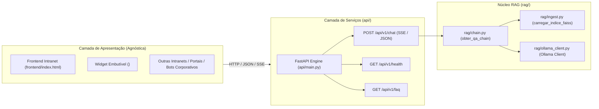

# ADR-0006 — Desacoplamento do Backend RAG via API REST/SSE e Frontend Independente para Intranet

- **Número:** ADR-0006
- **Título:** Desacoplamento do Backend RAG via API REST/SSE e Frontend Independente para Intranet
- **Status:** Aprovada
- **Data de Criação:** 23/11/2026
- **Data de Aprovação:** 23/11/2026

---

## Contexto

Com a homologação e entrega da versão estável **v2.0.0** do `agente-ia-rh`, o núcleo RAG está completamente operacional, validado contra um *golden dataset* documental de 15 perguntas e equipado com controle seguro de conectividade Ollama (ADR-0001), catálogo de modelos (ADR-0002), formatação pura LCEL (ADR-0003), persistência atômica FAISS com manifesto (ADR-0004) e governança estrita de dependências (ADR-0005).

Entretanto, na v2.0.0 a única interface existente para interação com o usuário é o `app.py` em **Streamlit**. Embora adequado para experimentação e monitoramento técnico interno, o Streamlit apresenta limitações estruturais para o consumo corporativo em larga escala por usuários leigos (funcionários e equipe de RH da intranet):
1. **Acoplamento Monolítico:** A aplicação Streamlit executa a interface e o pipeline RAG no mesmo processo Python, impossibilitando que outros sistemas corporativos (portais internos, intranets legadas em PHP/Java/Node, SharePoint, bots de mensageria Teams/Slack ou apps móveis) consumam as respostas do RAG.
2. **Complexidade Visual Técnica:** A interface analítica expõe termos e controles como "temperatura", "k-recuperação", "FAISS", "modelo Ollama" e rastros de debug que geram fricção para funcionários não técnicos.
3. **Falta de Padronização para Outras Empresas:** Se outra organização ou departamento desejar adotar a inteligência do RAG com sua própria identidade visual ou integrada à sua própria intranet corporativa, é obrigatório existir um contrato HTTP desacoplado e agnóstico de apresentação.

---

## Problema que Precisa ser Resolvido

1. **Ausência de Interface REST/SSE Padrão:** Não havia endpoints HTTP padronizados para receber perguntas e responder em tempo real via streaming (*Server-Sent Events*), inviabilizando integrações externas.
2. **Barreira de Adoção para Usuários Leigos:** Falta de uma interface limpa, rápida, sem jargões de IA, focada estritamente nas dúvidas cotidianas de RH (benefícios, férias, atestados, ponto, onboarding).
3. **Necessidade de Portabilidade Plug-and-Play:** Necessidade de permitir que qualquer página web de intranet hospede o chat com um simples componente reutilizável (`<script>` / Web Component).

---

## Decisão Proposta e Aprovada

### 1. Camada de API Headless com FastAPI (`api/`)

Criar uma camada de serviço HTTP independente utilizando **FastAPI**, estruturada da seguinte forma:
- **`POST /api/v1/chat`:** Recebe a mensagem do usuário e emite a resposta via *Server-Sent Events* (`media_type="text/event-stream"`) com chunks em tempo real gerados pela LCEL chain (`chain.stream()`). Suporta também modo síncrono (`stream=false`) retornando JSON com resposta consolidada e metadados de fontes (`page`, `text`).
- **`GET /api/v1/health`:** Diagnóstico detalhado de saúde do sistema, inspecionando conectividade ao daemon Ollama, presença e tamanho do índice FAISS e parâmetros do modelo configurado.
- **`GET /api/v1/faq`:** Lista de perguntas frequentes categorizadas para alimentar os chips visuais de sugestão na interface de usuários.
- **CORS Configurado para Intranet:** Middleware CORS liberando origens locais e de rede corporativa (`allow_origins=["*"]`, métodos seguros `GET`, `POST`, `OPTIONS`).

### 2. Frontend Independente e Desacoplado (`frontend/`)

Criar uma interface web 100% estática (HTML5 semântico, CSS3 moderno com variáveis corporativas e JavaScript ES6 nativo, sem necessidade de Node.js, Webpack ou build steps):
- **Design Amigável para Leigos:** Sem menção a parâmetros de Machine Learning; layout acolhedor com avatar do assistente, balões de conversa, chips de perguntas rápidas, indicador visual de digitação (*typing indicator*) e renderização amigável de citações das políticas internas ("Página X do Manual de RH").
- **Tratamento Educado de Perguntas Fora de Escopo:** O assistente orienta com gentileza quando a dúvida não faz parte do regulamento interno da empresa.

### 3. Widget Embutível / Web Component (`frontend/widget.js`)

Disponibilizar o Web Component customizado `<assistente-rh-chat>` que qualquer empresa pode incluir em sua intranet legada (ex.: WordPress, SharePoint, página estática) adicionando apenas:
```html
<script src="http://servidor-rh:8000/widget.js" defer></script>
<assistente-rh-chat api-url="http://servidor-rh:8000/api/v1"></assistente-rh-chat>
```

### 4. Coexistência Arquitetural

O `app.py` (Streamlit) **permanece preservado e funcional**, servindo como console operacional/analítico para o administrador do RH ou desenvolvedor inspecionar parâmetros avançados, enquanto o servidor `api.main:app` (FastAPI) serve a API pública e o frontend da intranet para os colaboradores da empresa.

---

## Diagrama da Arquitetura Desacoplada



---

## Consequências

### Positivas
- **Independência Total de Tecnologia:** Qualquer frontend corporativo (React, Vue, Angular, Mobile, Web Component nativo) pode consumir o mesmo assistente de RH via API padronizada.
- **Acessibilidade para Usuários Não Técnicos:** Interface limpa, intuitiva, com sugestões clicáveis e feedback visual sem atritos de engenharia.
- **Streaming Fluido (SSE):** Respostas transmitidas em tempo real geram sensação imediata de agilidade e transparência ao usuário.
- **Simplicidade de Implantação:** O servidor FastAPI hospeda tanto os endpoints REST quanto os arquivos estáticos do frontend (`frontend/`), dispensando infraestrutura adicional de proxy web para demonstrações locais.

### Negativas / Mitigações
- **Requisito de Novas Dependências:** Inclusão de `fastapi>=0.115.0` e `uvicorn>=0.30.0` no `requirements.txt`.
  *Mitigação:* Ambos são padrões consolidados da indústria Python, com suporte estável a Python 3.11 a 3.14 e baixo consumo de recursos.

---

## Critérios de Homologação

1. `GET /api/v1/health` deve retornar status HTTP 200 com informações sobre Ollama e FAISS.
2. `GET /api/v1/faq` deve retornar lista de perguntas estruturadas em categorias de RH.
3. `POST /api/v1/chat` deve responder via `text/event-stream` com chunks SSE e cabeçalho `Cache-Control: no-cache`.
4. `frontend/index.html` e `frontend/widget.js` devem carregar estaticamente sem erros no console do navegador e permitir o fluxo completo de perguntas e respostas.
5. Suíte automatizada em `tests/test_api.py` deve validar todos os contratos com 100% de sucesso.
