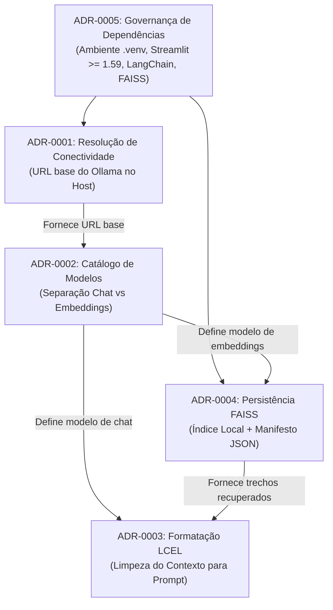

# Registro de Decisões de Arquitetura (ADRs) — V2

Este diretório contém os **Architecture Decision Records (ADRs)** que formalizam as decisões técnicas, justificativas e critérios de validação para a evolução do **agente-ia-rh** da Prova de Conceito (V1) para a versão estabilizada e evolutiva (V2).

---

## Contexto Operacional do Ambiente

- **Sistema Operacional Principal:** Ubuntu 26.04 LTS (instalação nativa).
- **Hardware do Host:** Processador Intel Core i7-1165G7 (4 núcleos / 8 threads), 16 GB de memória RAM e GPU integrada Intel Iris Xe (sem GPU dedicada NVIDIA).
- **Servidor de Inferência:** Ollama local em execução via systemd no host (`http://localhost:11434`), operando inferência em CPU com aceleração vetorial nativa.
- **Evidência Prática de Desempenho:** Testes práticos recentes conduzidos pela usuária em outros projetos no Ubuntu nativo apresentaram execução mais fluida e responsiva em comparação com o ambiente anterior sob WSL2. Essa observação foi incorporada como evidência empírica favorável à escolha do Ubuntu nativo como ambiente principal, sem transformá-la em um benchmark formal comparativo.
- **Topologias Arquiteturais:**
  - *Ambiente Principal:* Ubuntu nativo com ambiente virtual isolado (`.venv`).
  - *Ambiente Secundário Documentado:* Docker / Docker Compose.
  - *Ambiente Histórico:* WSL2 (mantido como contexto documental de evolução da V1, não como requisito da V2).

---

## Índice de Decisões

| Número | Título | Status | Resumo da Decisão |
| :--- | :--- | :--- | :--- |
| [ADR-0001](0001-resolucao-conectividade-ollama.md) | Resolução de Conectividade do Ollama | **Aprovada** | Remove subprocessos legados de WSL2 (`ip route`) e prioriza `OLLAMA_BASE_URL` com fallback estrito para `localhost:11434`. |
| [ADR-0002](0002-catalogo-modelos-ollama.md) | Catálogo Dinâmico e Separação de Modelos Ollama | **Aprovada** | Consulta `/api/tags` dinamicamente com suporte a `/api/show`, separa modelos de chat e embeddings, e define critérios de filtragem sem heurísticas cegas. |
| [ADR-0003](0003-formatacao-contexto-lcel.md) | Formatação Estrita do Contexto na Chain LCEL | **Aprovada** | Introduz função pura `formatar_documentos` para extrair estritamente `page_content`, evitando vazamento de objetos `Document` no prompt. |
| [ADR-0004](0004-persistencia-faiss.md) | Persistência Controlada do Índice FAISS | **Aprovada** | Implementa persistência local com manifesto `manifest.json`, fronteira de confiança para `pickle` e estratégia segura de substituição em Linux. |
| [ADR-0005](0005-dependencias-e-compatibilidade.md) | Governança de Dependências e Compatibilidade | **Aprovada** | Define execução nativa em `.venv` como principal, fixa matriz candidata com `streamlit>=1.59.0` e condiciona remoção de `langchain-openai`. |

---

## Relacionamento Conceitual entre as ADRs

As decisões de arquitetura da V2 possuem dependências conceituais diretas:

- **ADR-0001** define a URL resolvida de forma determinística, utilizada pela **ADR-0002** para consultar a API de tags.
- **ADR-0002** define o modelo de embeddings (`nomic-embed-text:latest`), parâmetro obrigatório validado pelo manifesto da **ADR-0004**.
- **ADR-0004** fornece a lista de documentos recuperados que a **ADR-0003** formata antes do envio ao modelo de linguagem selecionado na **ADR-0002**.
- **ADR-0005** estabelece o ambiente e a compatibilidade básica de pacotes para viabilizar todas as demais decisões.

---

## Estratégia Geral de Evolução da V2

A execução do planejamento está estruturada em três etapas progressivas e orientadas a validação prática:

### Etapa 1 — Saneamento e Estabilização
- Resolução segura de conectividade do Ollama (ADR-0001).
- Descoberta dinâmica de modelos de chat e separação do modelo de embeddings (ADR-0002).
- Formatação pura de texto do contexto na chain LCEL (ADR-0003).
- Resolução de caminhos com `pathlib` independente do diretório de trabalho.
- Validação limpa da matriz de dependências em `.venv` e higiene do Docker com `.dockerignore` (ADR-0005).
- Criação de suíte de testes unitários com mocks (`unittest.mock`) e pipeline de CI inicial.

### Etapa 2 — Persistência e Rastreabilidade
- Persistência controlada do índice FAISS com manifesto `manifest.json` e substituição segura em disco (ADR-0004).
- Invalidação determinística de cache vetorial por alteração de PDF, embeddings ou chunking.
- Rastreabilidade de fontes: renderização expansível de páginas e trechos associados estritamente à consulta atual na UI.
- Testes automatizados cobrindo os cenários de persistência e invalidação.

### Etapa 3 — Avaliação de Qualidade
- Curadoria de conjunto de perguntas de referência (*golden dataset*) baseadas na política interna da Nexus Tecnologia.
- Avaliação sistemática de recuperação (*Context Precision* e *Context Recall*).
- Comparação de desempenho, fidelidade e latência entre modelos locais disponíveis (`qwen3.5:4b` vs `llama3.1:8b` e candidatos avaliados na ADR-0002).
- Decisão orientada por dados empíricos sobre a necessidade ou não de busca híbrida (BM25) ou reranking.

---

## Anti-Escopo da V2 (O Que NÃO Implementar)

Para manter o foco, a simplicidade de manutenção e o respeito aos requisitos essenciais, os seguintes componentes estão expressamente fora do escopo da V2:

1. **FastAPI ou Separação em Microsserviços:** Desnecessário para uso interativo unificado; o Streamlit atende como frontend e orquestrador de sessão.
2. **LangGraph ou Orquestração Multiagente:** Desnecessário para consulta documental factual direta; grafos de decisão aumentam a complexidade sem benefício comprovado neste estágio.
3. **Bancos Vetoriais Externos (PostgreSQL/PgVector, Qdrant, Milvus):** Injustificado para o volume de manuais internos de demonstração; FAISS local atende com alta velocidade e baixo consumo de recursos.
4. **Serviços de Nuvem ou Modelos Proprietários:** Contraria o requisito de privacidade estrita e operação 100% local.
5. **Dados Reais de Funcionários:** A base deve continuar utilizando estritamente documentos sintéticos/didáticos (Nexus Tecnologia S.A.).
6. **Busca Híbrida BM25 e Rerankers Pesados:** Adicionados apenas se a Etapa 3 comprovar deficiência na recuperação vetorial pura.

---

## 📌 Registro de Trabalho Futuro e Escopo Separado (PoC Acadêmica / TCC)

Existe uma Prova de Conceito (PoC) exploratória anterior sendo considerada pela usuária como possível base temática para um Trabalho de Conclusão de Curso (TCC). Registra-se formalmente que:
- Essa PoC acadêmica será retomada em momento oportuno, em uma etapa e frente de trabalho totalmente separadas e autônomas.
- O escopo do projeto **agente-ia-rh** mantém-se estritamente focado no saneamento, estabilização e governança do Assistente de RH corporativo local.
- Não há compartilhamento de código, dependências, banco vetorial ou decisões de arquitetura entre o Assistente de RH e a referida PoC.
